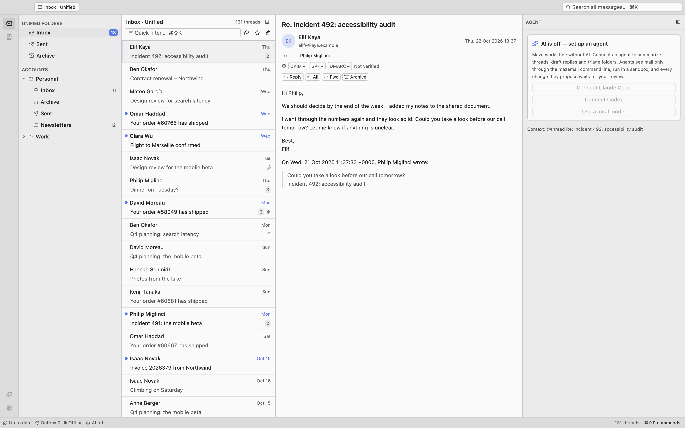

# Maze

**The agentic email client.** Crafted for speed and collaboration with humans and AI.

An open source, local-first email client written in Rust. Built like
[Zed](https://zed.dev) (GPU-rendered, fast, small, agent-native) and behaving like
[Thunderbird](https://www.thunderbird.net) (same layout, same shortcuts).

<picture>
  <source media="(prefers-color-scheme: dark)" srcset="docs/screenshots/app-real-data-dark.png">
  
</picture>

- **Local-first.** Your mail lives on your computer in one store. Opening a folder,
  scrolling through 100,000 messages or searching never waits for the server.
- **Crafted for speed.** A native GPU-rendered window (GPUI, Zed's UI framework), no browser
  engine. A cold start shows the message list in well under a second.
- **Nothing to relearn.** Thunderbird's panes, folders, Quick Filter, global search and
  keyboard shortcuts, so moving over from Thunderbird doesn't mean relearning anything.
- **Encrypted at rest.** The database, message files and search index are encrypted
  with a key that stays in the macOS keychain (or the Secret Service on Linux). A copy of
  your data directory is useless without it.
- **Agent-ready.** The `mazemail` command line client gives scripts and AI agents scoped,
  approved access to your mail: search, read, export, propose changes for you to
  review. No token, no mail.

The app is called **Maze**. Every technical identifier (crate, binary, CLI, data
directories, environment variables) is **`mazemail`**, because the `maze` crate name is
taken.

## Status

**Pre-alpha.** Maze is usable for reading, searching and triaging, but it isn't a
daily driver yet. Expect rough edges, and keep your mail on the server.

Works today:

- the encrypted store (SQLCipher database, encrypted message files and search index)
- IMAP, Gmail and Microsoft 365 accounts: the Add Account dialog or
  `mazemail account add`, with password or browser sign-in (Gmail with your own OAuth
  client ID)
- IMAP sync, including CONDSTORE/QRESYNC delta sync, IDLE and Gmail labels, of your
  subscribed folders
- import from mbox files, Maildir directories and Thunderbird profiles
- search with Gmail-style operators (`from:`, `has:attachment`, `after:` …)
- reading mail in a sanitized reader view, with DKIM/SPF/DMARC results
- archive, move, tag, flag and mark read, with undo
- tabs and splits like Zed's: mail views, single messages and drafts side by side,
  dragged into splits, restored after a restart, with the agent column staying right
- writing mail in a tab (Markdown, sent as plain text + HTML), each draft named with
  two random words, replies and forwards, local drafts, sending over SMTP (password or
  OAuth) with an outbox that never sends twice, a footer from the settings and an
  optional "Sent with Maze" line
- editing `settings.json` in a tab (`cmd-,`), applied on save, with its problems listed
  by line
- the `mazemail` CLI and `mazemail --headless` for scripts and agents
- updates in the background with a "Restart to update" button, and a rollback if a new
  version keeps failing to start

Not there yet:

- drafts on the server, send later, undo send, spell check, signatures per identity
- the agents column (the panel is visible, but no agent can be connected yet)
- filter rules (imported Thunderbird filters are kept, disabled)
- a settings window with forms (settings are edited as JSON for now), showing the
  recovery key

## Install

### macOS

Download `Maze-<version>-macos-aarch64.dmg` (Apple Silicon) or `…-x86_64.dmg` (Intel)
from [GitHub Releases](https://github.com/pmig/mazemail/releases) once the first
release is published, open it and drag Maze to Applications. From then on Maze updates
itself: it installs new versions in the background and shows **Restart to update** in
the title bar ([details](docs/getting-started.md#updates)). There is deliberately no
Homebrew cask (see [ADR-010](docs/adr/0010-auto-update.md)).

### Linux

Download `Maze-<version>-linux-<arch>.tar.zst` from the same page and unpack it to
`~/.local/`:

```sh
tar --zstd -xf Maze-*-linux-x86_64.tar.zst -C ~/.local
~/.local/mazemail.app/bin/mazemail
```

### Build from source

The toolchain is managed with [mise](https://mise.jdx.dev). On macOS you also need the
Xcode Command Line Tools; on Debian and Ubuntu, `script/linux-deps` installs the system
packages.

```sh
mise install          # Rust 1.99.1, cargo-nextest, cargo-deny, cargo-insta
mise start            # starts a dev build of Maze, with its own data directory
script/bundle-mac     # builds dist/mac-<arch>/Maze.app, the .dmg and the .app.tar.zst
```

Want to look around without your own mail? `MAZEMAIL_DEMO=1 mise start` shows a
synthetic mailbox, and `cargo xtask seed-demo --data-dir /tmp/maze-demo` creates a
real (encrypted) store with demo mail that the CLI can talk to.

## Quick start

1. **Start Maze.** On first launch it creates the storage key in your keychain and an
   empty store.
2. **Sign in the CLI.** The CLI talks to the running app and needs a token you approve
   in Maze:

   ```sh
   eval "$(mazemail login --profile triage --ttl 8h)"
   ```

   Inside the app bundle the CLI is `/Applications/Maze.app/Contents/MacOS/mazemail`;
   link it into your `PATH` or use an alias.
3. **Import mail.** An mbox file, a Maildir or a whole Thunderbird profile (accounts,
   identities, Local Folders, tags, address books and filters). Maze asks you to approve
   the import:

   ```sh
   mazemail import ~/old-mail.mbox
   mazemail import ~/Library/Thunderbird/Profiles/abcd1234.default-release --format thunderbird
   ```

4. **Add an account.** Use **Add Account…** in the folder pane, or the CLI with a
   writer token (`mazemail account add you@example.com`, password from the terminal or
   `--password-stdin`; `--oauth google` or `--oauth microsoft` for the browser
   sign-in). Importing your Thunderbird profile takes its accounts over too. Gmail
   needs your own Google OAuth client ID (`auth.google.client_id`) for now; see
   [Getting started](docs/getting-started.md#accounts).
5. **Search and read.**

   ```sh
   mazemail search 'from:anna has:attachment after:2026-09-01'
   mazemail show t_19bd
   ```

More in [docs/getting-started.md](docs/getting-started.md) and
[docs/cli.md](docs/cli.md).

## Where your data lives

| What                                          | macOS                                    | Linux                     |
| --------------------------------------------- | ---------------------------------------- | ------------------------- |
| Mail store (encrypted), socket, logs          | `~/Library/Application Support/mazemail` | `$XDG_DATA_HOME/mazemail` |
| `settings.json` (no mail content, no addresses) | `~/.config/mazemail`                   | `~/.config/mazemail`      |
| Storage key (Maze's only keychain item)       | keychain                                 | Secret Service            |
| Account passwords and OAuth refresh tokens    | in the encrypted mail store              | in the encrypted mail store |

Development builds use `mazemail-dev` and a separate keychain item, so they never touch
your real store. `MAZEMAIL_DATA_DIR` and `MAZEMAIL_CONFIG_DIR` override the
directories.

## Security in short

- Everything with mail content (database, message files, caches, search index) is
  encrypted with a random 256-bit key that never leaves the keychain. Account passwords
  and OAuth refresh tokens are in the encrypted database too, so Maze keeps one
  keychain item and reads it once per launch.
- The CLI never opens the store. It asks the running app over a Unix socket (mode
  0600), and every request that touches mail needs a token you approved, scoped to a
  profile (read-only, triage or writer), accounts and a lifetime.
- On purpose in plaintext: what you export, what the CLI prints for an approved token,
  attachments you open in other apps, notification text, and the Thunderbird profile
  you imported from.
- Linux is weaker than macOS: any program running as you can read an unlocked Secret
  Service collection, and with it the key.

The details are in [docs/security.md](docs/security.md). Report vulnerabilities
privately, see [SECURITY.md](SECURITY.md).

## Documentation

- [Getting started](docs/getting-started.md): install, first launch, import, accounts,
  keyboard shortcuts
- [The `mazemail` CLI](docs/cli.md): tokens, profiles, approvals and `--headless`
- [CLI reference for agents](docs/AGENTS-cli.md), generated from the command registry
- [Agents](docs/agents.md): the agent column, installing Claude Code, Codex, Gemini,
  Cursor and pi, sign-in, the sandbox, custom agents
- [Security](docs/security.md): encryption at rest, keys and recovery, API tokens
- [Releasing](docs/releasing.md): the maintainer checklist

## Contributing

Read [CONTRIBUTING.md](CONTRIBUTING.md) and [AGENTS.md](AGENTS.md) (naming, crate
layering, conventions). Architecture decisions are in [docs/adr/](docs/adr/README.md).
Run `mise run ci` before you commit.

## License

GPL-3.0-or-later, see [LICENSE](LICENSE).
