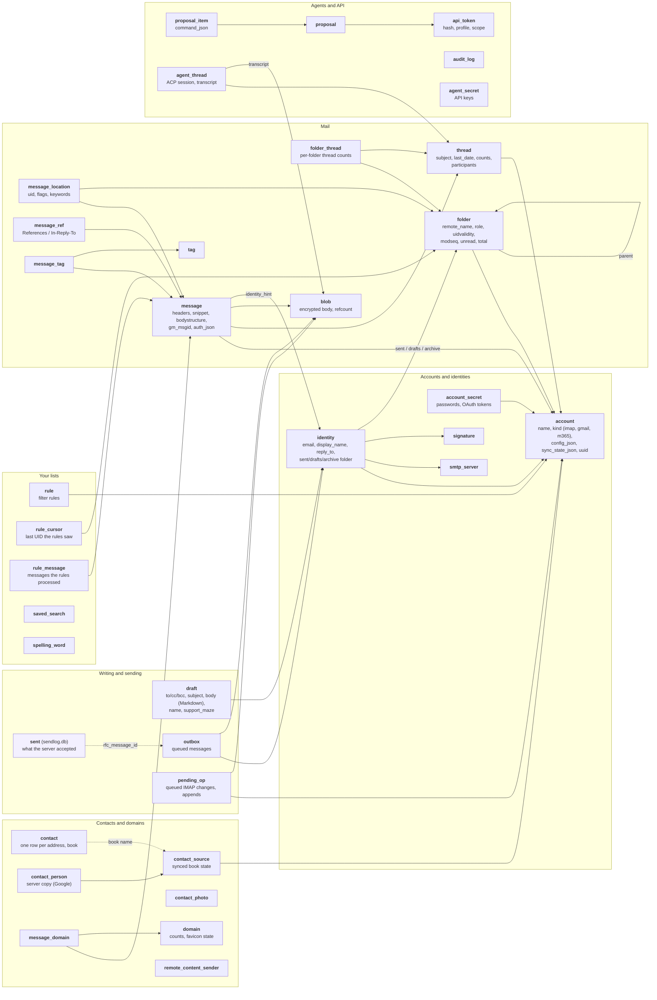

# Data model

What Maze stores, as of the v1 schema (`crates/store/migrations/main/0001_schema_v1.sql`,
33 tables) and the rules engine's two tables (`0002_rules.sql`) plus the send log (`crates/store/migrations/sendlog/`). Everything is in
SQLCipher databases encrypted by the vault ([ADR-017](adr/0017-account-secrets-in-the-vault.md));
message bodies, queued messages and agent transcripts are encrypted blobs referenced
from `blob`.

Arrows are foreign keys (child to parent). Dashed arrows are references by value without
a foreign key. Update this diagram with every schema change.

## Notes

- **`message` is per account**: one row per message and account, with its places in
  `message_location` (one row per folder it is in, with the IMAP UID and flags). A Gmail
  message with several labels is one `message` with several locations.
- **Threads** are per account too; `folder_thread` keeps the per-folder counts the message
  list shows without scanning messages.
- **`blob`** counts its references (triggers on `message`, `outbox`, `pending_op` and
  `agent_thread`), so unreferenced bodies can be removed.
- **Contacts**: `contact` has one row per address (the book is a string such as
  `google:<account uuid>`); `contact_source` and `contact_person` are the sync state and the
  server copy of synced books ([ADR-024](adr/0024-server-owned-contacts.md)).
- **Rules** ([ADR-029](adr/0029-message-rules.md)) keep their conditions and actions as
  JSON in `rule`. `rule_cursor` remembers, per watched folder and UIDVALIDITY, the
  highest UID the arrival rules have seen; `rule_message` the messages they processed,
  so each is filtered once.
- **The send log** (`sendlog.db`, table `sent`) records every message a server accepted,
  so a crash while sending never sends it twice.
