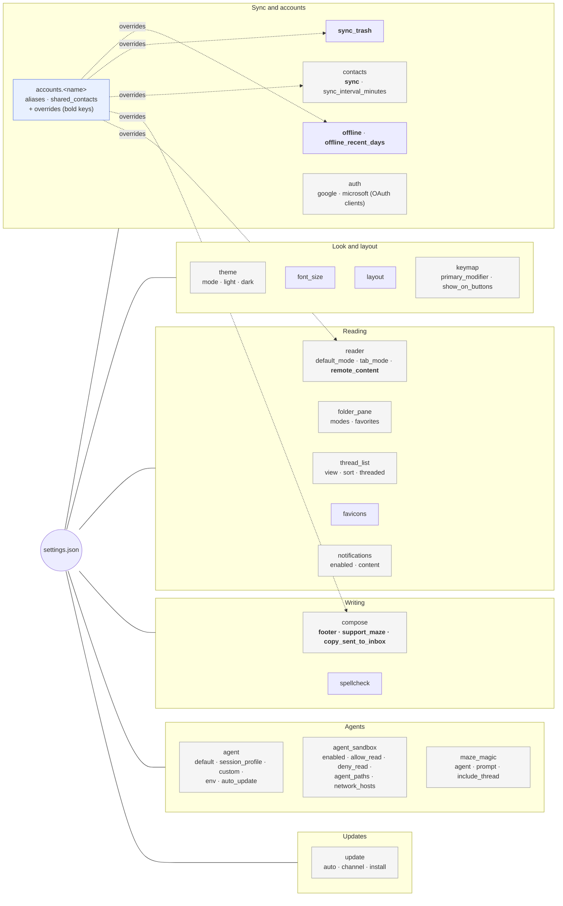

# Settings model

The structure of `settings.json`. The defaults, with a comment for every key, are in
[`assets/settings/default.jsonc`](../assets/settings/default.jsonc); the types and the JSON
Schema come from `crates/settings/src/content.rs`. Update this diagram with every new or
removed setting.

**Bold** keys can be overridden per account in `accounts.<name>`; `accounts.<name>` also
holds what only exists per account: its `aliases` and, for Microsoft accounts,
`shared_contacts`.



Example:

```jsonc
{
  "theme": { "mode": "dark" },
  "compose": { "footer": "Acme Inc." },
  "accounts": {
    "Work": { "offline": "all", "remote_content": "never" },
    "Private": { "footer": "", "support_maze": false }
  }
}
```
